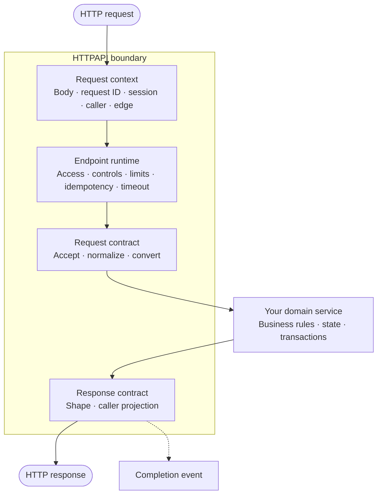

HTTPAPI is a set of narrow packages, not a full application framework. Use this model when deciding where new code should live.

## Decide by ownership

| Question | Owner |
| --- | --- |
| Can this JSON become a complete command value? | `param` |
| May this authenticated caller invoke the route? | `endpoint` |
| Does the current resource state permit the action? | Your domain service |
| Which fields may this caller receive? | `response` |
| How are credentials verified or audits stored? | Your injected adapters |
| How is the mounted API described? | `server` and `openapi/*` |

## Parse once

A request parser returns a complete value or one structured error. Normalization such as trimming, enum membership, null policy, and presence rules belongs in that parser. Do not decode into a loose struct and add a second HTTP validation phase later.

State-dependent rules remain domain work. For example, `customer_id` being a well-formed ID is a request concern; whether that customer belongs to the authenticated application is a domain concern.

## Keep endpoint policy off the request

`request.Req` is a safe representation of the incoming request. It does not know which endpoint will handle it. Method, authorization, caller availability, controls, limits, idempotency, timeouts, and operation identity belong on `endpoint.EndpointSpec` or `endpoint.JSONEndpointSpec`.

## Shape output at the boundary

Response shapes describe the public representation independently from storage structs. The renderer applies caller visibility and property selection before JSON encoding, so handlers do not need branches that delete sensitive fields.

## Inject infrastructure once

HTTPAPI defines interfaces for authentication, idempotency, controls, availability, audit, completion, and edge evidence. The service installs the real implementations during startup. This keeps the contract portable without pretending infrastructure is optional.
